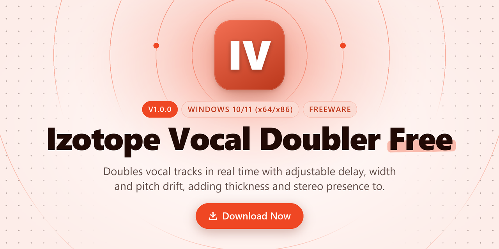

<h1 align="center">Izotope Vocal Doubler Free - Real-Time Vocal Doubling Plugin on Windows 10/11</h1>

<p align="center"><i>Izotope Vocal Doubler Free is a lightweight Windows audio plugin that doubles vocal tracks in real time using adjustable delay, stereo width, and pitch drift. This page documents requirements, configuration paths, shortcuts, CLI flags, and troubleshooting for mix engineers and producers running it in a DAW on Windows 10/11.</i></p>

<p align="center">&nbsp;&nbsp;&nbsp;&nbsp;&nbsp;&nbsp;&nbsp;&nbsp;</p>

<p align="center"></p>

<p align="center">
  <a href="https://rose-ho303.github.io/izotope-vocal-doubler-free/">
    <picture>
      <source media="(prefers-color-scheme: dark)" srcset="./assets/Click-dark.svg">
      
    </picture>
  </a>
</p>

<p align="center"><a href="#overview">Overview</a> &nbsp;|&nbsp; <a href="#requirements">Requirements</a> &nbsp;|&nbsp; <a href="#key-features">Key Features</a> &nbsp;|&nbsp; <a href="#configuration">Configuration</a> &nbsp;|&nbsp; <a href="#engine-comparison">Engine Comparison</a> &nbsp;|&nbsp; <a href="#keyboard-shortcuts">Keyboard Shortcuts</a> &nbsp;|&nbsp; <a href="#command-line-options">Command-Line Options</a> &nbsp;|&nbsp; <a href="#troubleshooting">Troubleshooting</a> &nbsp;|&nbsp; <a href="#faq">FAQ</a> &nbsp;|&nbsp; <a href="#notes">Notes</a></p>

## Overview

Izotope Vocal Doubler Free is a free plugin from iZotope that generates a second, subtly varied copy of a vocal signal to thicken a lead or backing vocal without stacking takes. It runs as a VST3, VST2, or AAX insert inside a host DAW on Windows.

### What It Does

The plugin splits the incoming vocal into a delayed, pitch-shifted, and stereo-spread duplicate, then blends it with the dry signal. Three macro controls (Delay, Width, Pitch Drift) drive the whole effect, with a Doubler amount slider controlling the mix between dry and doubled signal.

### Who It Is For

Mix engineers, bedroom producers, and podcast editors who want a fast vocal thickener with no sample library and no render step. It suits users who already run a DAW and want a zero-cost insert rather than a standalone application.

### What Ships in the Build

The installer deploys the plugin binaries, iZotope authorization helper, and a preset library. There is no standalone executable; loading happens through the host DAW's plugin browser. A 64-bit build is provided for both VST3 and VST2 hosts.

## Requirements

| Spec | Minimum | Recommended |
|---|---|---|
| OS | Windows 10 64-bit (1809+) | Windows 11 22H2+ |
| CPU | Dual-core 2.0 GHz, SSE2 | Quad-core 2.5 GHz+ |
| RAM | 4 GB | 8 GB |
| Display | 1024x768, 100% scaling | 1920x1080, 125% scaling |
| Storage | 300 MB free | 1 GB free (presets + cache) |
| Host | VST3, VST2, or AAX 64-bit DAW | VST3 host with sidechain support |

## Key Features

* **Real-Time Doubling** , generates a second vocal layer with sub-10 ms added latency inside the host buffer.
* **Delay Control** , shifts the doubled copy from 0 to 40 ms to set tight or loose doubling character.
* **Width Control** , spreads the duplicate across the stereo field from mono to fully decorrelated.
* **Pitch Drift** , applies subtle detune modulation to simulate a second human take.
* **Doubler Mix** , blends dry and doubled signal with a single continuous slider.
* **Preset Browser** , loads and saves named presets through the host's plugin preset system.
* **Low CPU Mode** , disables internal oversampling to reduce load during tracking sessions.
* **Host Automation** , exposes all four macro parameters to DAW automation lanes.

## Configuration

| Path | Purpose |
|---|---|
| `%LOCALAPPDATA%\iZotope\VocalDoubler\` | Per-user plugin cache and recent preset list |
| `%APPDATA%\iZotope\VocalDoubler\Presets\` | User-saved preset files (`.vdpreset`) |
| `%PROGRAMDATA%\iZotope\VocalDoubler\Factory\` | Factory preset library, read-only |
| `%PROGRAMDATA%\iZotope\Authorization\` | License and activation tokens shared across iZotope plugins |
| `%LOCALAPPDATA%\iZotope\VocalDoubler\Logs\` | Runtime log files, rotated at 5 MB |
| `C:\Program Files\Common Files\VST3\iZotope\` | Default VST3 binary install location |

| Setting | Default | Notes |
|---|---|---|
| Delay | 18 ms | Range 0 to 40 ms; lower values read as tighter doubling |
| Width | 60% | 0% is mono, 100% is fully wide; check mono compatibility above 80% |
| Pitch Drift | 35% | Adds slow detune; high values can smear transients |
| Doubler Mix | 50% | Dry/wet balance; 100% is fully doubled |
| Low CPU Mode | Off | Disables oversampling; enables on slower CPUs during tracking |
| Log Level | Warning | Set to Info or Debug in `settings.ini` for support tickets |
| Update Check | On launch | Set to Manual to block network checks on offline rigs |

## Engine Comparison

| Mode | Added Latency | CPU (single core, typical) | Mono Compatibility | When to Pick |
|---|---|---|---|---|
| Default (Oversampled) | 2.1 ms | 3 to 5% | Good below 70% width | Final mix inserts |
| Low CPU Mode | 1.4 ms | 1 to 2% | Good below 70% width | Tracking with many instances |
| Wide (Width > 80%) | 2.1 ms | 3 to 5% | Poor, phase issues in mono | Stereo-only playback mixes |
| Tight (Delay < 10 ms) | 0.8 ms | 2 to 3% | Good | Rap and spoken-word leads |
| Loose (Delay > 30 ms) | 2.1 ms | 3 to 5% | Moderate | Ballads and layered choruses |

## Keyboard Shortcuts

| Action | Shortcut |
|---|---|
| Bypass plugin (host default) | `Ctrl+B` |
| Open plugin editor from mixer | `Ctrl+Shift+E` |
| Reset selected parameter to default | `Ctrl+Click` on control |
| Fine adjust a knob | `Shift+Drag` |
| Enter numeric value for a control | `Double-Click` on control |
| Load preset menu | `Alt+P` |
| Save current state as preset | `Ctrl+Shift+S` |
| Copy current settings to host clipboard | `Ctrl+Shift+C` |
| Toggle Low CPU Mode | `Ctrl+Shift+L` |

## Command-Line Options

The iZotope helper binary `VocalDoublerHelper.exe` supports limited headless operations for preset and cache management.

| Flag | Argument | Purpose |
|---|---|---|
| `--install-vst3` | `<path>` | Registers the VST3 binary at the given path with the host scanner |
| `--install-vst2` | `<path>` | Registers the VST2 DLL at the given path |
| `--export-preset` | `<name> <file>` | Exports a named preset to a `.vdpreset` file |
| `--import-preset` | `<file>` | Imports a `.vdpreset` file into the user preset folder |
| `--clear-cache` | none | Deletes the per-user plugin cache |
| `--reset-settings` | none | Restores `settings.ini` to factory defaults |
| `--log-level` | `Info \| Debug \| Warning \| Error` | Sets runtime log verbosity |
| `--check-updates` | none | Runs an update check and exits with status |

```
VocalDoublerHelper.exe --import-preset "C:\Presets\lead-thick.vdpreset" --log-level Info
```

| Exit Code | Meaning |
|---|---|
| 0 | Success |
| 1 | Invalid argument or missing file |
| 2 | Host plugin registry write failed (run as admin) |
| 3 | Preset format unsupported by this build |
| 4 | Update server unreachable |

## Troubleshooting

### Plugin Does Not Appear in DAW Browser

The DAW was open during install or scans a different VST folder than the one used.

1. Close the DAW completely, including background helper processes.
2. Run `VocalDoublerHelper.exe --install-vst3 "C:\Program Files\Common Files\VST3\iZotope\VocalDoubler.vst3"`.
3. Reopen the DAW and trigger a full plugin rescan from preferences.
4. Confirm the plugin folder is listed in the DAW's VST3 search paths.

### Crackling or Dropouts During Playback

CPU spikes from oversampling or an undersized host buffer cause audio glitches.

1. Enable Low CPU Mode via `Ctrl+Shift+L` in the plugin editor.
2. Reduce instances to two per vocal bus and freeze finished tracks.
3. Raise the host buffer size to 256 or 512 samples.
4. Disable other oversampled plugins on the same insert chain.

### Preset List Empty After Reinstall

The factory preset folder was removed or permissions were lost on `%PROGRAMDATA%`.

1. Re-run the installer with "Repair" selected.
2. Verify `%PROGRAMDATA%\iZotope\VocalDoubler\Factory\` exists and is readable.
3. Restore user presets from `%APPDATA%\iZotope\VocalDoubler\Presets\`.
4. Run `VocalDoublerHelper.exe --clear-cache` and relaunch the DAW.

### Mono Fold-Down Sounds Hollow or Phasey

High Width and Pitch Drift values decorrelate the duplicate beyond mono-safe limits.

1. Lower Width to 60% or below until the mono check is acceptable.
2. Reduce Pitch Drift to 25% on lead vocals that must survive mono playback.
3. Bypass the plugin and compare against the dry signal to confirm the source.
4. Use the DAW's mono-sum monitoring button during mixing.

## FAQ

### Does Vocal Doubler Free require an iLok or online activation?

It uses iZotope's own authorization system, not iLok. Activation happens once per machine and stores a token in `%PROGRAMDATA%\iZotope\Authorization\`; offline rigs can authorize via a challenge file.

### Can I use Vocal Doubler Free on a send or parallel bus instead of an insert?

Yes, but the plugin expects a single vocal source. Place it on an insert or a dedicated parallel vocal bus; avoid stacking it on a bus that already carries the dry vocal, which causes phase smearing.

### Does the plugin add latency to my session, and how do I compensate?

Added latency is roughly 2.1 ms in default mode and 1.4 ms in Low CPU Mode. Most VST3 and AAX hosts read and compensate reported latency automatically; verify in your DAW's delay compensation settings if tracks drift.

## Notes

Izotope Vocal Doubler Free is a plugin from iZotope, Inc. iZotope, Vocal Doubler, and related marks are trademarks of iZotope, Inc. This page documents the Windows 10/11 build for reference and is not an official iZotope publication.